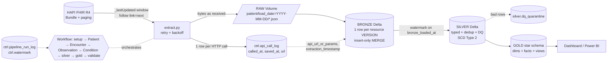
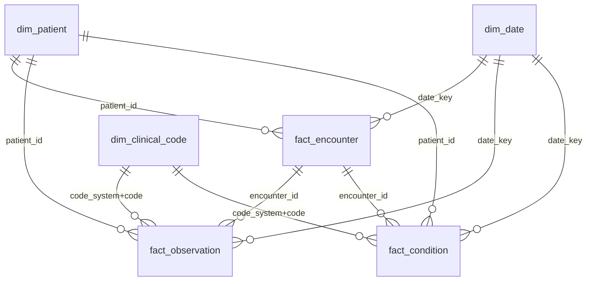

# FHIR R4 Medallion Lakehouse (Databricks)

Incremental ingestion of **Patient, Encounter, Observation, Condition** from the public HAPI FHIR R4 server into a
Raw → Bronze → Silver (SCD Type 2) → Gold lakehouse, orchestrated as a Databricks Workflow, with full audit trail.

## 1. Architecture



| Layer | Location | Content | Mutability |
|---|---|---|---|
| Raw | `/Volumes/workspace/fhir_raw/landing/<resource>/load_date=YYYY-MM-DD/<run>__<res>__<date>__pNNNNN.json` | Bundle pages **byte-for-byte** as returned | immutable |
| Bronze | `fhir_bronze.<resource>` | one row per resource *version*: `resource_json`, `payload_hash`, `extraction_timestamp`, `api_url_or_params`, `source_file`, `load_date`, `run_id`, `bronze_loaded_at` | append-only |
| Silver | `fhir_silver.<resource>` | typed/flattened columns + `row_hash`, `valid_from`, `valid_to`, `is_current`, `scd_version`, `dq_flags` | SCD2 |
| Gold | `fhir_gold.*` | star schema + reporting views | rebuilt each run |
| Control | `fhir_ctrl.*` | `api_call_log`, `pipeline_run_log`, `watermark` | append / upsert |

## 2. How incremental loading works
* **Window**: `_lastUpdated=ge<start>&_lastUpdated=lt<end>&_sort=_lastUpdated&_count=100`, then follow `Bundle.link[relation=next]` until none.
* `mode=daily` → exact `[D, D+1)` window: deterministic, re-runnable, perfect for the 2–3 day backfill.
  `mode=incremental` → `(watermark, now)` using `ctrl.watermark` (`api:<Resource>`), for steady-state scheduling.
* Transient failures (429/5xx/timeouts) retry with exponential backoff and honour `Retry-After`.
* Re-running a day is **idempotent**: Bronze de-duplicates on `(resource_id, payload_hash)`; Silver only changes on a new hash.

## 3. Versioning / SCD Type 2 (Silver)
* `row_hash` = SHA-256 of all business attributes (not ingestion metadata) → "did anything change?".
* Changed record ⇒ **one MERGE** closes the current row (`valid_to = new.valid_from`, `is_current = false`) and inserts the new row (`scd_version + 1`)
  using the *merge-key / NULL-merge-key staging* pattern (see `scd2.py`).
* `valid_from` is the source's own `meta.lastUpdated` (business time). `silver_loaded_at` / `bronze_loaded_at` / `extraction_timestamp` give system time.
* Safeguards: late/out-of-order versions (older `lastUpdated`) are ignored; several versions of one id in a batch are applied oldest→newest.
* **When was each API called / saved?** → `ctrl.api_call_log.called_at` / `saved_at` (view `gold.vw_api_call_audit`).
* **Prove it**: notebook `90_scd2_demo` replays a real patient with a changed address through the pipeline and shows the before/after history.

## 4. Gold data model


Facts carry `is_orphan_patient` (FK not found) instead of silently dropping rows — the public server contains references to non-Patient subjects and dangling ids.

| Reporting view | Purpose |
|---|---|
| `vw_patient_360` | one row per patient with encounter/observation/condition counts |
| `vw_encounters_daily` | volume + average duration by day and class |
| `vw_top_conditions` | ranked conditions |
| `vw_vitals` | LOINC-mapped vital signs (HR, BP, weight, BMI …) |
| `vw_patient_history` / `vw_scd2_change_audit` | SCD2 history and what changed |
| `vw_pipeline_health` / `vw_api_call_audit` / `vw_data_quality` | operational evidence |

## 5. Run it (Databricks Free Edition)
1. Sign up for **Databricks Free Edition** (the successor to Community Edition) → import this folder (Workspace → *Create → Git folder* with your repo URL, or *Import* the ZIP).
2. Run `notebooks/00_setup`. The last cell tells you whether the workspace can reach `hapi.fhir.org`.
3. Run `notebooks/05_backfill_driver` (defaults: last 3 days, Patient → Encounter → Observation → Condition, then Silver → Gold → Validate).
   While developing, set `max_pages` (e.g. 25) to cap volume per resource per day.
4. Optional: run `90_scd2_demo`, then query the `gold.vw_*` views.
5. Workflow: edit `<YOUR_EMAIL>` in `workflows/fhir_medallion_job.json` and create the job (UI → Jobs → *Create job* → ⋮ → *Edit as JSON*, or `databricks jobs create --json @…`).

### If outbound internet is blocked
Free Edition restricts outbound traffic to a list of trusted domains; at the time of writing the docs say LinkedIn verification (when offered on your account) unlocks outbound internet access. If it is still blocked:
```bash
python local/extract_local.py --from-date 2026-11-08 --days 3 --run-id bf-offline --max-pages 25     # same extractor, runs on your laptop
databricks fs cp -r ./landing dbfs:/Volumes/workspace/fhir_raw/landing/                              # or upload via Catalog → Volumes
# then in 05_backfill_driver: source=landing, landing_run_id=bf-offline
```
Everything downstream (Bronze → Gold, audit tables) is identical.

## 6. Requirement traceability
| Requirement | Where |
|---|---|
| 2–3 days incremental, pagination | `windows.py`, `fhir_client.iter_pages`, `05_backfill_driver` |
| Store JSON as-is | `extract.py` writes `resp.content` unchanged (unit-tested byte equality) |
| JSON → Delta in Bronze via Spark | `bronze.py`, `01_ingest` |
| `extraction_timestamp`, `api_url_or_params` | Bronze columns, sourced from `ctrl.api_call_log` |
| When API called / saved | `api_call_log.called_at`, `saved_at` |
| Detect daily changes + SCD2 | `scd2.py`, `silver.py`, `90_scd2_demo` |
| Raw bucketed by date, folder per object | `raw/<resource>/load_date=YYYY-MM-DD/` |
| Silver clean + dedupe | `silver_transform.py`, `silver.py` (+ quarantine) |
| Gold optimised for reporting | `gold.py` |
| Pipeline order Patient→Encounter→Observation→Condition | `workflows/fhir_medallion_job.json`, `05_backfill_driver` |
| Metadata logging | `ctrl.pipeline_run_log`, `ctrl.api_call_log`, `ctrl.watermark` |
| Modular, no hard-coding | `config/pipeline_config.yml`, `src/fhir_lakehouse/` |
| Documentation of tables/relationships | this file |

## 7. Tests
`pytest tests -q` (needs `pyspark==3.5.3`): pagination/retry/max-pages, window maths, byte-identical raw files, Bronze metadata,
JSON flattening for all four resources (incl. partial dates under ANSI mode and absolute reference URLs), SCD2 staging
(new / changed / unchanged / late-arriving), and that every Gold SQL statement executes.

## 8. Design decisions, trade-offs and known limitations
* **Bronze stores `resource_json` as a string** and Silver parses it with an explicit schema → schema drift in the API never breaks ingestion; fields can be added to Silver later without re-extracting.
* **SCD2 lives in Silver**, Bronze is the immutable version store. Gold dims read `is_current` rows; full history stays queryable.
* **Deletes**: FHIR search never returns deleted resources, so deletions are not detected. Production fix: read `_history` / `Bundle.type=history` and soft-close rows.
* **Transformations use Spark** (not Dataflow Gen2) — the brief allows either; Dataflow Gen2 is Fabric-only and unavailable on Databricks.
* **XML** (optional extension) is not implemented. The design isolates parsing in `bronze.make_entries_udf` and `silver_transform`; an `_format=xml` extractor plus `from_xml` would slot in there.
* **Power BI** (optional) is not included; the Gold layer is shaped for it (star schema, conformed `dim_date`, ready-made views). A Databricks AI/BI dashboard on the same views is the Free-Edition-friendly alternative.
* Public HAPI data is test data: expect odd/dangling references (surfaced via `is_orphan_patient`, `dq_flags`, `vw_data_quality`).
* Production hardening I would add: Unity Catalog grants, Delta `OPTIMIZE`/liquid clustering, alerting on failed tasks, secret-scoped auth for a real FHIR server, CI running `pytest` + `databricks bundle validate`.
